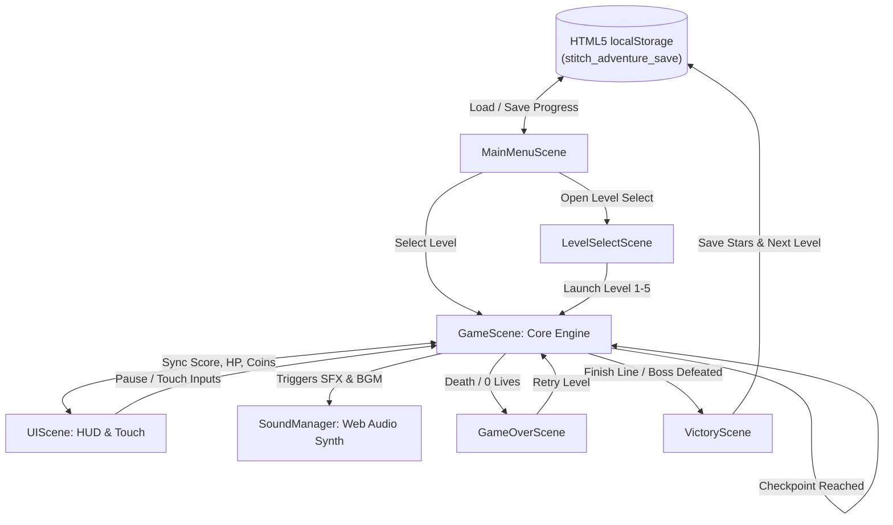

# Technical Specification: STITCH ADVENTURE (2D Platformer)

**Role**: Product Manager & Lead Architect (@pm)  
**Date**: November 20, 2026  
**Document Status**: Draft for User Approval  
**File Location**: `production_artifacts/Technical_Specification.md`  

---

## 1. Executive Summary

**"STITCH ADVENTURE"** is a vibrant, premium 2D platformer adventure game inspired by the timeless precision of *Super Mario Bros*, reimagined with the chaotic charm, heart, and energy of Disney's **Stitch (Experiment 626)**.

The player embarks on an odyssey spanning 5 distinct, hand-crafted worlds—from sun-drenched Hawaiian beaches and lush tropical canopies to bubbling volcanic caverns, strange alien planets, and Captain Gantu's dreadnought citadel for an epic multi-phase boss finale.

The game is engineered for zero-friction web deployment using **Phaser 3** and **Vite (JavaScript / HTML5 Canvas / WebGL)**, providing 60 FPS performance, responsive layout scaling across Desktop and Mobile devices, tactile virtual touch controls, dynamic Web Audio synthesis, and an offline-first persistent progression system via HTML5 `localStorage`.

---

## 2. Character Design & Animation Specifications: Stitch (Experiment 626)

### 2.1 Visual Anatomy & Proportions
Stitch is rendered with authentic cartoon-proportioned visual features:
- **Body & Skin**: Deep alien blue fur (`#2255cc` / `#1b44a6`) with a distinct light-blue belly/chest oval (`#6ca6ff`) and darker periorbital eye markings (`#103588`).
- **Head & Face**: Oversized head with signature large pointed bat-like alien ears with soft magenta/pinkish interior folds (`#de5b8a`), large expressive dark eyes with white specular catchlights, cute dark nose, and tuft of hair atop his head.
- **Physical Demeanor**: Compact, bouncy, dynamic center of mass with low crouch and expressive ears that react to physics (drooping when falling/hurt, perking up on jump, flapping during spin attacks).

### 2.2 Animation State Machine
| State | Trigger / Condition | Visual Frames & Behavior |
| :--- | :--- | :--- |
| **Idle** | Horizontal velocity == 0, grounded | Breathing belly cycle, ear twitch, periodic curious eye blink. |
| **Walk** | Horizontal velocity != 0, \|vx\| < 180 | 4-frame bobbing walk cycle with alternating feet and ear sway. |
| **Run / Dash** | \|vx\| >= 180 (speed boost or sustained movement) | Forward lean, arms swept back, dust trail particle emission. |
| **Jump** | Grounded -> Jump button pressed | Upward propulsion pose, ears flared back, feet tucked up. |
| **Double Jump** | Mid-air -> Jump button pressed | 360-degree acrobatic somersault tuck with cosmic spiral particle burst. |
| **Fall** | Vertical velocity > 0, not grounded | Arms outstretched, ears fluttering upward against wind drag. |
| **Attack (Spin / Claw)** | Attack key pressed (cooldown 350ms) | Rapid horizontal whirlwind spin with claws out, activating enemy damage hitbox. |
| **Blaster Shot** | Attack key while Plasma Power-up is active | Quick-draw dual red plasma blasters firing energy bolts. |
| **Take Damage** | Collision with hazard/enemy without invulnerability | Recoil backward knockback, stunned expression, 1.5s invincibility flash (flicker). |
| **Victory** | Triggering Level Finish Line Totem / Goal | Happy celebratory leap, arms raised in a "Hoola/Aloha" pose with starburst sparkles. |

---

## 3. World & Level Design Progression

The game features 5 distinct, progressively challenging levels with multi-layered parallax backgrounds and unique hazards:

```
[Level 1: Hawaiian Beach] ──> [Level 2: Jungle Adventure] ──> [Level 3: Volcano Island]
                                                                        │
[Level 5: Final Adventure & Boss] <── [Level 4: Alien Planet] <─────────┘
```

### Level 1: Hawaiian Beach (Introduction & Flow)
- **Theme**: Sun-kissed golden sand beaches, crystal turquoise ocean waves, swaying coconut palms, hibiscus flowers, and fluffy white clouds.
- **Parallax Layers**: Layer 1 (Sky & Sun), Layer 2 (Distant islands & clouds), Layer 3 (Ocean shoreline & palms), Layer 4 (Playable sandy terrain & docks).
- **Hazards & Enemies**: Sand crabs (patrol left-right), diving seagulls, gentle water gaps.
- **Mechanics Introduced**: Basic jump, double jump, coin collecting, first checkpoint tiki totem, coconut bash.
- **Difficulty**: 1/5.

### Level 2: Jungle Adventure (Verticality & Dynamics)
- **Theme**: Dense Hawaiian rainforest, ancient banyan trees, hanging moss, cascading waterfalls, and wooden suspension bridges.
- **Parallax Layers**: Layer 1 (Misty jungle canopy), Layer 2 (Distant waterfalls & mountains), Layer 3 (Mid-ground foliage & giant ferns), Layer 4 (Mossy platforms).
- **Hazards & Enemies**: Jungle beetles, thorny vine barriers, aggressive tree frogs, collapsing wooden log platforms, moving vine swings.
- **Mechanics Introduced**: Horizontally and vertically moving platforms, bouncy pink jungle mushrooms (super jump).
- **Difficulty**: 2.5/5.

### Level 3: Volcano Island (Precision & Environmental Hazards)
- **Theme**: Obsidian rock caves, active caldera, incandescent lava flows, smoke plumes, and fiery glow.
- **Parallax Layers**: Layer 1 (Smoky red/ash sky), Layer 2 (Volcanic ridges & lava fountains), Layer 3 (Cracked basalt pillars), Layer 4 (Charred rock platforms).
- **Hazards & Enemies**: Lava pits (instant hazard recoil), falling stalactites/fireballs from ceiling, magma flame-hoppers.
- **Mechanics Introduced**: Sinking platforms in lava, timed fireball geysers, dash power-ups.
- **Difficulty**: 3.5/5.

### Level 4: Alien Planet (Sci-Fi & Anti-Gravity Mechanics)
- **Theme**: Extraterrestrial neon crystalline landscape, strange flora, distant ringed gas giants, and cybernetic platforms.
- **Parallax Layers**: Layer 1 (Cosmic nebula & twin moons), Layer 2 (Neon crystal spires), Layer 3 (Floating asteroid chunks), Layer 4 (High-tech metallic platforms).
- **Hazards & Enemies**: Patrolling security drones with laser vision, electrifying laser gate barriers, floating alien jellyfish.
- **Mechanics Introduced**: Anti-gravity jump fields (low gravity physics), teleportation pads, shield power-ups.
- **Difficulty**: 4.5/5.

### Level 5: Final Adventure & Dreadnought Citadel (The Boss Encounter)
- **Theme**: Captain Gantu's command warship, metallic catwalks, red warning klaxons, conveyor belts, and massive plasma batteries.
- **Section 1: The Gauntlet**: Conveyor belts, crushers, moving laser grids, high-speed platforming.
- **Section 2: The Boss Battle - Captain Gantu / Galactic War Machine**:
  - **Health Bar**: 10 Boss Hit Points displayed in a dedicated HUD bar.
  - **Phase 1 (Blaster Barrage)**: Boss moves across elevated platforms, firing plasma bursts; player must dodge and jump on glowing overhead switches or deflect blasts.
  - **Phase 2 (Earthquake & Drop Traps)**: Boss slams ground, dropping hazard crates and unleashing drone minions; player can spin attack drones into the boss.
  - **Phase 3 (Enraged Overdrive)**: Faster attacks, sweeping laser beams, requiring mastery of double jumping and power-up usage to deliver the final hits.
  - **Victory Resolution**: Boss machine powers down with fireworks, cage releases Hawaii postcards/friends, victory celebration screen unlocked.
- **Difficulty**: 5/5.

---

## 4. Core Systems & Gameplay Mechanics

### 4.1 Health, Lives & Damage System
- **Health**: 3 Hearts (6 hit points, each heart represents 2 HP: full heart, half heart, empty heart).
- **Damage**: Contact with standard enemies deducts 1 HP (half heart). Hazard pits (lava/abyss) respawn Stitch at the last activated Checkpoint with 1 full heart deducted.
- **Invulnerability**: Taking damage grants 1500ms of invulnerability frames (i-frames) with alpha flickering and enemy collision ignore.
- **Lives System**: Player starts with 3 Lives.
  - Collecting 100 Golden Coins awards +1 Extra Life.
  - Collecting a rare "Chili Dog / Coffee Mug" awards +1 Extra Life or Full Heal.
  - Reaching 0 Lives triggers the **Game Over Screen** with options to "Continue from Checkpoint" or "Main Menu".

### 4.2 Movement & Physics Tuning (Arcade Platformer Precision)
- **Physics Engine**: Phaser 3 Arcade Physics.
- **Horizontal Velocity**: Max run speed = 260 px/s, acceleration = 1200 px/s², ground drag = 1000 px/s².
- **Jump Physics**: Jump impulse = -480 px/s, gravity = 1100 px/s².
- **Variable Jump Height**: Releasing jump early cuts upward velocity by 50% for tight, responsive control.
- **Double Jump**: Allowed once per airborne cycle until touching ground or bouncy mushroom; resets vertical velocity to -440 px/s with celebratory aerial spin.
- **Coyote Time**: 100ms grace window after leaving a platform ledge allowing a valid jump.
- **Jump Buffering**: 120ms input buffer storing jump requests right before touching ground.

### 4.3 Checkpoint System
- Placed strategically at the 33% and 66% marks of each level.
- Represented by an inactive Tiki Totem / Hawaiian Flag.
- Running past the checkpoint triggers an energetic animation (spins, blooms flowers, or glows neon) and saves the coordinate as the active respawn point for the current session.

### 4.4 Collectibles & Power-Ups
1. **Tropical Gold Coins**: Worth 50 points; 100 coins = +1 Life. Emits spinning coin shimmer and chime sound.
2. **Heart Fruit**: Restores 1 Heart container (2 HP).
3. **Plasma Blaster (Power-Up)**: Equips Stitch with ranged blasters for 15 seconds or until hit; allows firing forward plasma bolts that instantly vanquish non-boss enemies.
4. **Energy Shield (Power-Up)**: Surrounds Stitch with a pulsing iridescent bubble that absorbs 1 fatal hit or hazard contact.
5. **Turbo Coffee (Power-Up)**: Increases speed by 40% and grants continuous jump height boost for 10 seconds.

---

## 5. User Interface (UI), Menus & HUD

### 5.1 Main Menu Scene (`MainMenuScene`)
- **Visuals**: Animated Hawaiian beach background with parallax drifting clouds, ocean wave surf, and an animated interactive Stitch on the title screen who reacts when hovered or tapped.
- **Title Logo**: Stylized tropical cartoon typography: `"STITCH ADVENTURE"`.
- **Buttons**:
  - `PLAY`: Starts from Level 1 or continues from latest unlocked level.
  - `LEVEL SELECT`: Grid of 5 Level Cards showing thumbnail, completion stars (0-3), and high scores.
  - `SETTINGS`: Modal for BGM Volume slider, SFX Volume slider, Mobile Controls Toggle, and Reset Save Data.
  - `EXIT / ABOUT`: Story lore, controls recap, and credits.

### 5.2 In-Game HUD
Fixed screen overlay with transparent backdrops:
- **Top Left**: 3 Health Hearts (SVG/Canvas animated sprites), Lives Counter (`x3` with mini Stitch icon).
- **Top Center**: Level Indicator badge (`LEVEL 1: HAWAIIAN BEACH`), Boss Health Bar (only in Level 5).
- **Top Right**: Coin Counter (`🪙 x 24`), Score Counter (`SCORE: 014200`), Pause Button (`⏸`).

### 5.3 Overlay Menus
- **Pause Menu**: Semi-transparent dark overlay; options: `RESUME`, `RESTART LEVEL`, `SETTINGS`, `MAIN MENU`.
- **Game Over Screen**: Dramatic slow-mo fade, "OHANA MEANS FAMILY... NEVER GIVE UP!", Final Score, `TRY AGAIN`, `MAIN MENU`.
- **Victory Screen**: Fireworks and confetti particle emitter, Level Completion Time, Stars Earned, `NEXT LEVEL`, `MAIN MENU`.

---

## 6. Audio Architecture (Procedural Web Audio API)

To guarantee instantaneous, zero-dependency browser execution with no broken CDN links:
- **Audio Synthesizer Engine**: Built-in Web Audio API sound generator providing rich melodic chiptune/tropical synth tracks and SFX:
  - **BGM Tracks**:
    - Hawaiian Beach Theme (Ukulele-style arpeggios, upbeat tropical melody)
    - Jungle Mystery Theme (Percussive marimba rhythms and rhythmic bass)
    - Volcano Danger Theme (Driving minor chords, dramatic tension)
    - Alien Planet Theme (Ethereal sci-fi synth pulses)
    - Boss Battle Theme (High-energy orchestral techno cadence)
  - **SFX**: Jump (`boing`), Double Jump (`whoosh`), Coin Pickup (`high-bell chime`), Attack (`slash`), Enemy Hit (`pop`), Stitch Hurt (`ouch`), Level Complete (`fanfare fanfare`), Game Over (`somber jingle`).

---

## 7. Controls & Input Mapping

### 7.1 Desktop (Keyboard)
- **Move Left**: `A` or `Left Arrow`
- **Move Right**: `D` or `Right Arrow`
- **Jump / Double Jump**: `SPACE` or `W` or `Up Arrow`
- **Attack (Spin / Shoot)**: `J` or `X` or `Shift`
- **Pause Game**: `ESC` or `P`

### 7.2 Mobile / Touch Devices
- Automatically detected or toggled via Settings.
- **Left Thumb Virtual D-Pad**: Crisp on-screen circular buttons (`◀` Left, `▶` Right) with active press states.
- **Right Thumb Action Buttons**: Large circular button (`▲` Jump) and red circular button (`⚔` Attack).
- **Top Right Corner**: Direct touchable `⏸` Pause button.

---

## 8. Technical Architecture & Tech Stack

### 8.1 Stack Selection
- **Game Framework**: **Phaser 3** (`v3.80+`) – Industry standard for 2D HTML5 canvas/WebGL physics, spritesheet animation, cameras, tilemaps, and audio.
- **Build Tool / Bundler**: **Vite** – Lightning-fast modern dev server, clean ESM modules, frictionless bundling, and HMR.
- **Language**: Modern **JavaScript (ESNext)** with structured object-oriented modules.
- **Asset Architecture**: Custom programmatic 2D vector/canvas sprite generation engine creating crystal-clear, authentic Stitch animations, enemy sprites, parallax backgrounds, and modular level tilesets directly in-memory, combined with support for drop-in high-res PNG replacements.
- **Storage**: `localStorage` persisting `stitch_adventure_save` (unlocked levels, high scores, coins, settings).

### 8.2 Application Directory Structure (`app_build/`)
```
app_build/
├── index.html                   # HTML5 Entrypoint with viewport meta & canvas container
├── package.json                 # Dependencies (Phaser 3, Vite) and build scripts
├── vite.config.js               # Vite development and bundle configuration
├── public/                      # Static icons and metadata
└── src/
    ├── main.js                  # Game initialization & Phaser configuration
    ├── config/
    │   └── gameConfig.js        # Gravity, dimensions (960x540 16:9), scaling rules
    ├── scenes/
    │   ├── BootScene.js         # Asset generation, loading bar, procedural sprites
    │   ├── MainMenuScene.js     # Animated title, Stitch menu mascot, navigation
    │   ├── LevelSelectScene.js  # Level unlock cards & high scores
    │   ├── SettingsScene.js     # Volume & touch control toggles
    │   ├── GameScene.js         # Core platformer engine & level runner
    │   ├── UIScene.js           # Independent overlay HUD, hearts, score, touch controls
    │   ├── PauseScene.js        # Pause menu modal
    │   ├── GameOverScene.js     # Game over sequence
    │   └── VictoryScene.js      # Level complete celebration & stats
    ├── entities/
    │   ├── Player.js            # Stitch state machine, physics, animations, attacks
    │   ├── Enemy.js             # Base enemy class & specialized behaviors (Crab, Bat, Golem, Drone)
    │   ├── Boss.js              # Captain Gantu 3-phase boss logic & attacks
    │   ├── Collectible.js       # Coins, Hearts, Power-ups
    │   └── Platform.js          # Moving, sinking, and bouncy platforms
    ├── levels/
    │   ├── LevelData.js         # Level definitions (Beach, Jungle, Volcano, Alien, Citadel)
    │   └── LevelBuilder.js      # Procedural & tile-based level generator
    ├── audio/
    │   └── SoundManager.js      # Web Audio API music synth and SFX generator
    └── utils/
        ├── AssetGenerator.js    # Procedural canvas generator for Stitch & environmental art
        └── Storage.js           # LocalStorage wrapper for persistence
```

### 8.3 State Management & Data Flow


---

## 9. QA & Acceptance Criteria

1. **Autonomous Playability**: Every single one of the 5 levels is completely beatable with unique visuals, obstacles, and enemy behaviors.
2. **Character Feel**: Stitch moves smoothly, jumps with responsive variable height, double jumps crisply, attacks with responsive hitboxes, and displays authentic animations.
3. **Boss Fight Execution**: Level 5 culminates in an epic 3-phase boss fight against Captain Gantu with telegraphing attacks, visible boss health bar, and victory transition.
4. **Responsive Performance**: Scales seamlessly across screen sizes (16:9 aspect ratio, fit mode) on both desktop keyboard and mobile touch screens.
5. **Zero 404s / Instant Boot**: No external image or sound dependency failures—procedural asset generation guarantees 100% immediate operational readiness out of the box.

---

## 10. Approval Gate

As required by the Autonomous Development Team Protocol:
> **Do you approve of this tech stack and specification? You can safely open `production_artifacts/Technical_Specification.md` and add comments or modifications if you want me to rework anything!**
